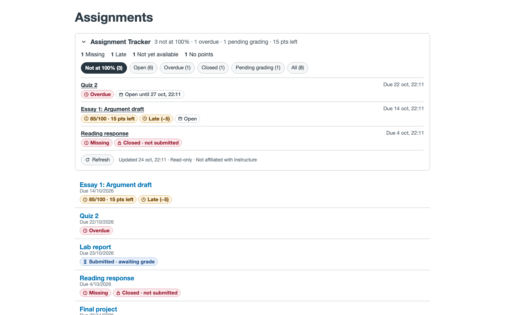

# Assignment Tracker for Canvas

A free, open-source browser extension for students who use Canvas LMS. On a course's **Assignments** page it shows, at a glance:

- **Which assignments are not at full points yet**: "85/100 · 15 pts left"
- **Availability**: Open, Closed, Not yet available (by date or by module), **Overdue**
- **Other states**: Missing, Late (with deducted points), Submitted · awaiting grade, Grade not posted, Excused, Retry available, and ungraded / 0-point assignments (never flagged as missing points)

It adds a small badge to each assignment row and a collapsible summary panel with filters: **Not at 100%**, **Open**, **Overdue**, **Closed**, **Pending grading**, **All**.

**Website:** https://davidmenendez9901.github.io/assignment-tracker-for-canvas/ · [Privacy Policy](https://davidmenendez9901.github.io/assignment-tracker-for-canvas/privacy.html) · [Terms of Use](https://davidmenendez9901.github.io/assignment-tracker-for-canvas/terms.html)

> **Disclaimer:** Not affiliated with, endorsed by, or sponsored by Instructure, Inc. Canvas is a trademark of Instructure, Inc.

## Screenshots



## Privacy in one paragraph

The extension reads your assignments from the Canvas site you are already logged in to, using that site's own API with your existing session. It never asks for a password or API token, never contacts any other server, has no analytics or telemetry, and loads no remote code. It only sends GET (read) requests: it cannot submit, edit, or delete anything. See [PRIVACY.md](PRIVACY.md).

## Install from source

Requirements: Node.js 22.12 or newer.

```sh
git clone https://github.com/davidmenendez9901/assignment-tracker-for-canvas.git
cd assignment-tracker-for-canvas
npm install
npm run build
```

This produces `dist/chrome` and `dist/firefox`.

**Chrome / Edge / Brave**
1. Open `chrome://extensions` and turn on **Developer mode**.
2. Click **Load unpacked** and choose `dist/chrome`.

**Firefox** (140 or newer)
1. Open `about:debugging#/runtime/this-firefox`.
2. Click **Load Temporary Add-on…** and choose `dist/firefox/manifest.json`.
3. If Firefox shows the extension needs permission for `instructure.com`, allow it from the extensions menu.

Then open any course's **Assignments** page in Canvas.

## Using it with a custom Canvas address

Works automatically on `*.instructure.com`. If your school uses its own address (for example `canvas.myuniversity.edu`):

1. Open that Canvas site and click the extension's toolbar icon.
2. Click **Enable on this site**. A settings tab opens with the address filled in.
3. Click **Allow** and accept your browser's prompt.
4. Reload the Canvas tab.

You can also add or remove addresses any time from the extension's **Options** page. Access is granted per site, and only the site's `/courses/…` pages are used.

## What the statuses mean

| Badge | Meaning |
|---|---|
| `85/100 · 15 pts left` | Graded below full points. Late penalties are already included in the score. |
| `100/100` (subtle) | Full points (or `+X extra` for extra credit). |
| **Due in 3 days** / **Due in 5 hours** | Open and not submitted yet. Highlighted when due within 48 hours. |
| **Overdue** | Past the due date, still open, nothing submitted. Only for online submissions. |
| **Missing** | Canvas (or your teacher) marked it missing. |
| **Late (−5)** | Submitted late; points deducted by the late policy. |
| **Closed** / **Closed · not submitted** | Past the "available until" date, or locked. |
| **Opens Mar 20** / **Locked (module)** | Not available yet: by date, or until you complete a module's requirements. |
| **Submitted · awaiting grade** / **Awaiting regrade** | Submitted and not graded yet, or resubmitted after grading. |
| **Grade not posted** | Graded, but your teacher hasn't released the grade yet. |
| **Excused** / **No points** | Doesn't count; never shown as missing points. |
| **Retry available (1/3 used)** | Limited attempts remain and it's still open. |

"Not at 100%" includes graded-below-full, incomplete, missing, overdue, and closed-without-submission assignments. Work that isn't due yet is not counted (it's under **Open**).

## Development

```sh
npm run watch      # rebuild dist/chrome on change
npm test           # unit + DOM tests (Vitest)
npm run check      # typecheck, lint, test, build
npm run zip        # package release/ zips (after build)
```

Layout:

```
src/core      pure classification/formatting logic (no DOM, fully tested)
src/api       read-only, same-origin Canvas API client
src/content   content script: panel, badges, row matching, theming
src/shared    custom-domain permission + script registration
src/background, src/popup, src/options
manifests/    base.json + chrome.json / firefox.json overrides
```

See [CONTRIBUTING.md](CONTRIBUTING.md).

## Known limitations

- Canvas changes its page markup from time to time. If badges stop appearing, the summary panel still works; please open a "Canvas compatibility" issue.
- Dates are compared in absolute time and shown in your browser's time zone, which may differ from your Canvas profile time zone.
- The panel lists all assignments in the course (including other grading periods); a checkbox lets you hide ones not listed on the current page.

## Use at your own risk

This is a free, independent tool provided **"as is", without warranty of any kind** (see the [MIT License](LICENSE) and the [Terms of Use](https://davidmenendez9901.github.io/assignment-tracker-for-canvas/terms.html)). It shows what Canvas reports, but it can be wrong or out of date. **Canvas is the official source**: always confirm deadlines and grades there. The authors are not responsible for missed deadlines, grades, or any other consequence of using it.

## License

[MIT](LICENSE)
